<a href="https://anshh.live">
  <picture>
    <source media="(prefers-color-scheme: dark)" srcset="./assets/hero-dark.svg">
    
  </picture>
</a>

  
  
  
  

  

### `$ whoami`

- 🎓 B.Tech Computer Science at **IIIT Dharwad**, graduating May 2027. Based in Jabalpur, India. Can join immediately, and happy to relocate.
- 🤖 I build LLM agents for production: tool calling, RAG, voice, and the tests and guardrails that make them safe to ship.
- 🧪 I test agents like software: scripted-caller harnesses, Vitest and Pytest suites, Playwright end-to-end runs.
- 📫 Open to **AI engineer, forward-deployed engineer and full-stack** roles (internship or new grad). Visa sponsorship needed outside India.

### `$ ls ~/work`

<a href="https://hobbyfi.in">
  <picture>
    <source media="(prefers-color-scheme: dark)" srcset="./assets/work-hobbyfi-dark.svg">
    
  </picture>
</a>
<a href="https://askburrito.com">
  <picture>
    <source media="(prefers-color-scheme: dark)" srcset="./assets/work-burrito-dark.svg">
    
  </picture>
</a>

### `$ ls ~/projects`

<a href="https://github.com/anshhoff/canapply"><picture><source media="(prefers-color-scheme: dark)" srcset="./assets/proj-canapply-dark.svg"></picture></a>
<a href="https://github.com/anshhoff/sahara"><picture><source media="(prefers-color-scheme: dark)" srcset="./assets/proj-sahara-dark.svg"></picture></a>
<a href="https://github.com/anshhoff/pixel-agents"><picture><source media="(prefers-color-scheme: dark)" srcset="./assets/proj-pixelagents-dark.svg"></picture></a>
<a href="https://github.com/anshhoff/FitForm"><picture><source media="(prefers-color-scheme: dark)" srcset="./assets/proj-fitform-dark.svg"></picture></a>

### `$ cat stack.txt`

   
   
  

  <b>AI:</b> Gemini (Vertex AI, Live API) · LiveKit Agents · Mastra · Vercel AI SDK · Qdrant · pgvector · tool calling · RAG · provider failover
   
  <b>Testing:</b> Vitest · Pytest · Playwright

### `$ git log --stat`

  <picture>
    <source media="(prefers-color-scheme: dark)" srcset="https://raw.githubusercontent.com/anshhoff/anshhoff/output/github-contribution-grid-snake-dark.svg">
    
  </picture>

  <picture>
    <source media="(prefers-color-scheme: dark)" srcset="https://streak-stats.demolab.com?user=anshhoff&theme=tokyonight&hide_border=true&background=0D111700&ring=A78BFA&fire=F472B6&currStreakLabel=22D3EE">
    
  </picture>

  Also: GDG IIIT Dharwad app-dev core member (mentored 5 juniors, ran workshops for 30+ students) · Razorpay AI Buildathon 2026

