<a href="https://anshh.live">
  <picture>
    <source media="(prefers-color-scheme: dark)" srcset="./assets/hero-dark.svg">
    
  </picture>
</a>

  <a href="https://anshh.live"><b>anshh.live</b></a> &nbsp;·&nbsp;
  <a href="https://www.linkedin.com/in/ansh-hardaha"><b>LinkedIn</b></a> &nbsp;·&nbsp;
  <a href="mailto:ansh.iiit2027@gmail.com"><b>Email</b></a> &nbsp;·&nbsp;
  <a href="https://x.com/anshhoff"><b>X</b></a>

 

<a href="https://hobbyfi.in"><picture><source media="(prefers-color-scheme: dark)" srcset="./assets/work-hobbyfi-dark.svg"></picture></a>
<a href="https://askburrito.com"><picture><source media="(prefers-color-scheme: dark)" srcset="./assets/work-burrito-dark.svg"></picture></a>

<a href="https://github.com/anshhoff/canapply"><picture><source media="(prefers-color-scheme: dark)" srcset="./assets/proj-canapply-dark.svg"></picture></a>
<a href="https://github.com/anshhoff/sahara"><picture><source media="(prefers-color-scheme: dark)" srcset="./assets/proj-sahara-dark.svg"></picture></a>
<a href="https://github.com/anshhoff/pixel-agents"><picture><source media="(prefers-color-scheme: dark)" srcset="./assets/proj-pixelagents-dark.svg"></picture></a>
<a href="https://github.com/anshhoff/FitForm"><picture><source media="(prefers-color-scheme: dark)" srcset="./assets/proj-fitform-dark.svg"></picture></a>

 

  <picture>
    <source media="(prefers-color-scheme: dark)" srcset="https://skillicons.dev/icons?i=ts%2Cpy%2Cnodejs%2Cnextjs%2Creact%2Cfastapi%2Cpostgres%2Csupabase%2Cfirebase%2Cdocker%2Cgcp%2Cswift&theme=dark">
    
  </picture>

 

<picture>
  <source media="(prefers-color-scheme: dark)" srcset="https://raw.githubusercontent.com/anshhoff/anshhoff/output/github-contribution-grid-snake-dark.svg">
  
</picture>
